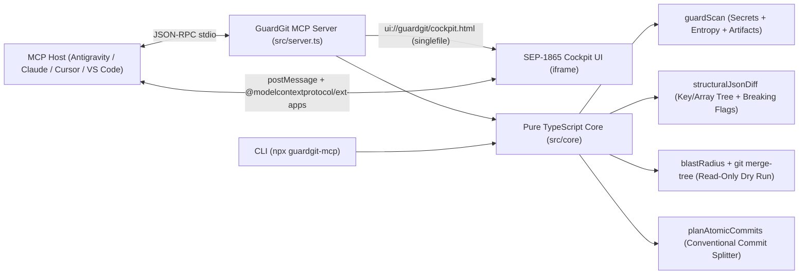

# GuardGit MCP

**Pre-Commit DevSecOps Safety Net & Structural Diff Cockpit for Autonomous AI Coding Agents**

GuardGit MCP is a 100% open-source (MIT), zero-mutation **SEP-1865 MCP App** and **CLI** (`npx guardgit-mcp`) that protects repositories from the four most common failure modes of autonomous AI coding agents:

1. **Secret & Artifact Leakage (`scan_precommit_guard`)**: Catches `.env` files, AWS/OpenAI/Anthropic/GitHub/Stripe/Cloudflare/Google/Slack/npm tokens, JWTs, PEM private keys, database credentials, high-entropy assignments, large/binary blobs (`>1 MB` configurable), SQLite files, and build artifacts (`node_modules/`, `dist/`, `.next/`, `*.vsix`, `*.db`) — returning a `0-100` risk score, `PASS / WARN / BLOCK` verdict, redacted previews, `.gitignore` blocks, and copyable `git rm --cached` remediation commands.
2. **Unreadable Minified/Large JSON Diffs (`diff_structural_json`)**: Replaces 10,000-character single-line diffs in `package.json`, `tsconfig.json`, lockfiles, i18n locale dictionaries (`en.json`, `tr.json`), and Terraform/Kubernetes JSON with semantic key-level trees, keyed array matching, bulk-shift noise suppression, and automatic breaking-change flags.
3. **Blind Force-Pushes & Merge Surprises (`analyze_blast_radius`)**: Computes directory-level blast-radius heatmaps across sensitive surfaces (auth/RBAC, migrations, CI/CD, API contracts, runtime config) and executes strictly read-only, in-memory `git merge-tree --write-tree` conflict dry-runs against your target branch with **zero working-tree mutations**.
4. **40-File AI Mega-Commits (`plan_atomic_commits`)**: Withholds blocked secrets/artifacts and groups safe changes into logically ordered Conventional Commits (`build`, `ci`, `chore`, `feat`, `fix`, `refactor`, `test`, `docs`) with ready-to-run staging commands.

## Architecture



## Quickstart

### 1. Run as an MCP Server (stdio)

```bash
npx guardgit-mcp
```

### 2. Run Directly in Terminal or CI Pre-Commit Hooks

```bash
# Scan working tree & staged diffs (exits code 2 on BLOCK with --strict)
npx guardgit-mcp scan . --strict

# Semantic JSON diff between two files (or git HEAD vs working tree)
npx guardgit-mcp diff old.json new.json
npx guardgit-mcp diff --repo . --file package.json --base HEAD

# Blast-radius score + read-only git merge-tree conflict dry-run
npx guardgit-mcp blast . --target main

# Generate an atomic Conventional Commit split plan
npx guardgit-mcp plan .
```

## Host Configuration

### Antigravity (Native SEP-1865 Plugin with Side Pane & Sidebar)

Build and copy the self-contained plugin bundle:

```bash
npm install
npm run build
cp -R ./plugin ~/.gemini/config/plugins/guardgit-mcp
```

PowerShell:

```powershell
npm install; npm run build
Copy-Item -Recurse -Force ".\plugin" "$HOME\.gemini\config\plugins\guardgit-mcp"
```

Open **GuardGit Cockpit** directly from the side pane (`+` menu) or the left sidebar.

### Claude Desktop / Claude Code

Add to `claude_desktop_config.json` or `.mcp.json`:

```json
{
  "mcpServers": {
    "guardgit": {
      "command": "npx",
      "args": ["-y", "guardgit-mcp"]
    }
  }
}
```

### Cursor

Add to `.cursor/mcp.json`:

```json
{
  "mcpServers": {
    "guardgit": {
      "command": "npx",
      "args": ["-y", "guardgit-mcp"]
    }
  }
}
```

## Exposed MCP Tools & UI Resource

- **UI Resource**: `ui://guardgit/cockpit.html` (`text/html;profile=mcp-app`, `prefersBorder: false`, bundled single-file HTML with zero external CDN calls).
- **`open_guardgit_cockpit`**: Runs the full repo health overview (Guard + Blast Radius + Atomic Split + modified JSON detection) and opens the interactive cockpit (`aux_pane` and `global` entrypoints).
- **`scan_precommit_guard`**: Scans a repository path, raw unified diff, or in-memory file array for secrets, high-entropy assignments, large blobs, binaries, and build artifacts.
- **`diff_structural_json`**: Computes a semantic key/array diff with breaking-change flags on two JSON strings or a tracked Git file vs `HEAD`.
- **`analyze_blast_radius`**: Scores commit blast radius (`0-100`), renders a folder-level heatmap, and runs a read-only `git merge-tree --write-tree` conflict dry-run.
- **`plan_atomic_commits`**: Splits staged/unstaged changes into ordered Conventional Commits while automatically excluding blocked secrets and artifacts.

All tool arguments are optional; invoking any tool with `{}` returns a complete default view for the current working directory.

## Development & Testing

```bash
npm install
npm run build
npm test
```

## Security & Privacy

- **100% local & read-only**: GuardGit never pushes, checks out, resets, or mutates your working tree, and makes zero network requests.
- **Automatic redaction**: Detected secret tokens are masked (`sk-a***...***9f2a`) before returning tool results so raw credentials are never echoed into LLM conversation logs.

## License

MIT License — Copyright (c) 2026 Hessam Mamagani. See [LICENSE](./LICENSE).
